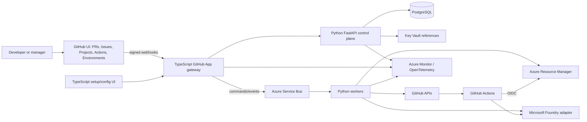

# Architecture

## 1. Principles

1. Git is desired state; deployments promote immutable releases.
2. Customer Azure resources and identities remain customer owned.
3. Central service stores control metadata, not inference payloads.
4. GitHub is the primary interaction surface.
5. Optional capabilities are versioned modules behind explicit contracts.
6. Preview/unstable Foundry features are isolated behind provider adapters.
7. Every asynchronous operation is idempotent, observable, and tenant scoped.
8. One codebase supports central-hosted and customer-hosted editions.

## 2. Logical topology

## 3. Deployable components

| Component | Technology | Responsibility |
|---|---|---|
| `apps/github-app` | TypeScript, GitHub SDK/Octokit | App authentication, webhook verification/ack, GitHub API façade, setup callback |
| `apps/web` | TypeScript UI | Guided setup, plan review, settings, diagnostics, audit exploration |
| `services/control-plane` | Python 3.13+, FastAPI, Pydantic v2 | Tenant/project/module/config APIs, authorization, plans, audit queries |
| `services/worker` | Python 3.13+ | Durable command handlers, policy/evaluation orchestration, Azure/Foundry adapters |
| `packages/contracts` | OpenAPI/JSON Schema | Cross-language contracts and generated clients |
| `packages/policy` | Python | Versioned policy packs, results and remediation contracts |
| `infra` | Bicep | ACA, identity, Key Vault, Service Bus, PostgreSQL, Monitor, networking |
| workflow templates | GitHub Actions YAML | Validation, build, provenance, deploy, evaluate, promote, drift |

For the first vertical slice, the TypeScript gateway and UI may share one process, and Python API/worker may share one image with separate commands. Boundaries remain contractual so scaling can separate them later.

## 4. Hosting editions

### Central hosted
- One operated control plane serves many GitHub installations.
- Tenant partition key is installation/organization tenant ID; every DB query and queue message carries it.
- Customer workflows deploy into customer subscriptions using customer-configured OIDC identities.
- No central identity receives broad customer subscription rights unless a customer explicitly chooses an App-managed deployment mode; that mode is off by default.

### Customer hosted
- Customer deploys the same Bicep modules into its subscription.
- Single-tenant mode can simplify network and database configuration but cannot disable core authorization.
- Customer registers a private App or points an allowed public App installation to its instance according to distribution policy.
- Upgrades use signed releases and documented schema migrations.

## 5. Event and command flow

1. Gateway reads raw webhook bytes, validates `X-Hub-Signature-256`, delivery ID and event type before JSON processing.
2. It persists an inbox record keyed by installation + delivery ID and returns quickly.
3. It publishes a tenant-scoped normalized event.
4. Worker loads project/module configuration, authorizes the action and creates a command/execution record.
5. Provider adapters call GitHub/Azure/Foundry with bounded retries respecting `Retry-After` and rate-limit headers.
6. Outbound mutations use idempotency/business keys and an outbox record.
7. Worker writes audit evidence and updates a Check Run/Issue/deployment status.
8. Dead-letter items surface in operations and require replay with the original tenant and idempotency keys.

## 6. Release/promotion model

`source commit -> validated build -> immutable release -> Dev deployment -> evaluation evidence -> Test promotion -> Production promotion`

A release record contains commit SHA, artifact digest, dependency lock hashes, configuration schema version, agent definition/version, workflow run, SBOM/attestation references, evaluations, and policy pack versions. Environment deployment binds the release to environment-specific references. Promotion never recompiles source.

Foundry hosted-agent deployment via `azd` can provision/deploy and create an agent version, but is treated as a provider implementation. Application smoke tests are mandatory because deployment success does not prove behavior.

## 7. Configuration hierarchy

Highest precedence first:
1. Time-bounded approved exception.
2. Environment/project config in `.foundryops/project.yaml`.
3. Organization policy pack assignment.
4. Product defaults.

Secrets are references (`keyVaultSecretUri`, GitHub environment secret name), never values. Schema rejects unknown top-level keys unless a versioned extension namespace is used.

## 8. Tenancy and authorization

- Stable subject: GitHub installation ID + organization/account ID; user authorization comes from current GitHub membership/role, not cached display names.
- Every resource row has `tenant_id`; high-risk paths also include repository/project/environment.
- Central edition uses PostgreSQL row-level security plus application predicates and cross-tenant tests.
- Queue message includes tenant, actor, authorization snapshot reference, correlation, causation, idempotency and expiry.
- Webhook receipt does not imply authorization to deploy; command execution revalidates installation and environment policy.

## 9. Resilience

- At-least-once event delivery with idempotent handlers.
- Transactional outbox/inbox.
- Deployment concurrency key: `tenant/project/environment`.
- Exponential backoff with jitter and maximum age; no blind retry for authorization/validation failures.
- Circuit breaker for provider incidents.
- Database point-in-time restore and tested backup procedure.
- Graceful degradation: checks can report provider unavailable; Production gates fail closed for mandatory evidence.

## 10. Observability

Use W3C trace context and OpenTelemetry. Required dimensions: component, operation, result, provider, tenant pseudonymous ID, project ID, environment, correlation ID, workflow run. Do not log tokens, webhook bodies by default, prompts, inference payloads, secret values, or customer content. Audit events are immutable business evidence and separate from diagnostic logs.
